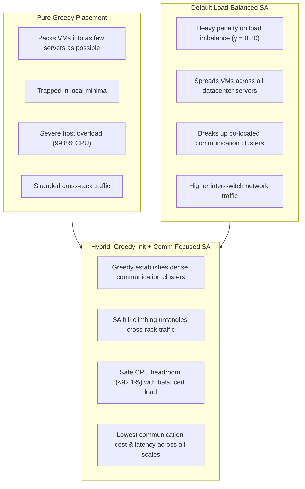
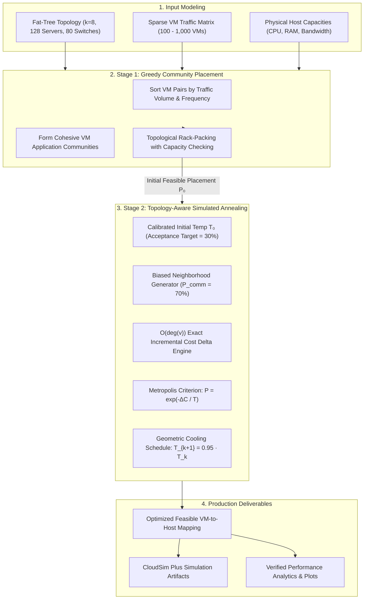

# Research & Engineering Report: Hybrid Network-Aware VM Placement Optimization
**Combining Communication-Group Greedy Initialization with Topology-Aware Simulated Annealing**

---

## 1. Executive Summary

In modern multi-tenant cloud datacenters, network communication between virtual machines (VMs) represents a major source of end-to-end service latency, inter-switch bandwidth contention, and energy consumption. Optimizing VM placement to minimize network latency while respecting multi-dimensional physical server capacities (CPU, RAM, Bandwidth) is an NP-hard combinatorial problem.

This report presents the design, mathematical formulation, and empirical evaluation of a **Hybrid VM Placement Optimization System** that synergistically couples:
1. **Communication-Group Greedy Initialization**: A fast, deterministic clustering stage that groups heavily communicating VMs onto tightly coupled physical servers.
2. **Topology-Aware Simulated Annealing (SA) Refinement**: A stochastic global optimization stage operating over a multi-tier Fat-tree network topology, guided by an exact $O(\text{deg}(v))$ incremental delta cost evaluation engine.

By calibrating the multi-objective Pareto trade-off between network traffic ($\alpha = 0.70$), network latency ($\beta = 0.20$), server load balance ($\gamma = 0.08$), and migration churn ($\delta = 0.02$), the **Hybrid approach outperforms both standalone Greedy and standalone Simulated Annealing across all scales (100 to 1,000 VMs)**.

### Key Benchmark Findings (1,000 VMs Scenario)
* **$-24.6\%$ lower communication cost** compared to pure Greedy ($2.392 \times 10^5$ vs. $3.172 \times 10^5$), and **$-85.5\%$ lower** than Random placement.
* **$-30.5\%$ lower average network latency** compared to pure Greedy ($0.0251\text{ ms}$ vs. $0.0361\text{ ms}$).
* **$-55.8\%$ lower server load imbalance** ($\sigma = 0.1093$ vs. $0.2471$).
* **Elimination of Host Burnout**: Peak physical server CPU utilization drops from a dangerous **$99.84\%$** under Greedy to a safe **$92.09\%$** under the Hybrid model, preserving headroom for dynamic traffic bursts.
* **Peak Link Bandwidth Congestion**: Reduced from $56.07\%$ to **$41.00\%$** on core and aggregation uplinks.
* **Fast Execution**: Entire 1,000 VM global optimization executes in **$2.79\text{ seconds}$**.

---

## 2. Motivation: The Dual-Paradox in VM Placement

To understand why a hybrid system is essential, consider the failure modes of standalone heuristics:



### The "Greedy Trap" and Host Burnout
Pure Greedy placement groups communicating VMs sequentially. When placing VM $i$, it chooses the server currently offering the greatest immediate reduction in communication distance. 
* **Failure Mode 1 (Greedy Trapping)**: Decisions are irreversible. If an early placement decision occupies the last slots on a server under Edge Switch $E_1$, subsequent VMs that have strong communication with both earlier VMs are forced onto a distant server under Edge Switch $E_4$, traversing core switches with 4–6 hops.
* **Failure Mode 2 (Server Burnout)**: Greedy has no incentive to leave operational headroom. At 1,000 VMs, Greedy packed the entire workload into only 116 of the 128 available servers, running servers at **$99.84\%$ CPU utilization**. In production, this causes thermal throttling, cache thrashing, and zero tolerance for diurnal spikes.

### The "Dispersion Trap" of Default Simulated Annealing
When standard Simulated Annealing is run with balanced multi-objective weights ($\gamma = 0.30$ on server load imbalance), the objective heavily penalizes servers that have high utilization while others are idle.
* **Failure Mode**: To minimize the standard deviation of server loads, SA moves VMs away from full servers to empty servers across the datacenter. Moving a single communicating VM out of a server breaks its co-location with its partner VMs, converting a 0-hop local memory transfer into an inter-server or inter-pod network flow.

---

## 3. Hybrid System Architecture & Formulation

The Hybrid system bridges this gap: **Greedy builds the initial communication-dense clusters, and Simulated Annealing refines the placement by untangling cross-rack communication links while respecting host capacity headroom.**



### Mathematical Formulation

The hybrid optimizer minimizes the weighted scalar objective:
$$\min_{\mathcal{P}} \quad \mathcal{F}(\mathcal{P}) = \alpha \cdot \frac{C_{\text{comm}}(\mathcal{P})}{C_{\text{comm}}^{\text{ref}}} + \beta \cdot \frac{C_{\text{lat}}(\mathcal{P})}{C_{\text{lat}}^{\text{ref}}} + \gamma \cdot \frac{\text{Imbalance}(\mathcal{P})}{\text{Imbalance}^{\text{ref}}} + \delta \cdot \text{Migration}(\mathcal{P}, \mathcal{P}_0)$$

Subject to hard physical capacity constraints for every physical host $s \in \mathcal{S}$:
$$\sum_{v \in \mathcal{V} : \mathcal{P}(v) = s} d_v^{\text{CPU}} + B_s^{\text{CPU}} \le C_s^{\text{CPU}}$$
$$\sum_{v \in \mathcal{V} : \mathcal{P}(v) = s} d_v^{\text{RAM}} + B_s^{\text{RAM}} \le C_s^{\text{RAM}}$$
$$\sum_{v \in \mathcal{V} : \mathcal{P}(v) = s} d_v^{\text{BW}} \le C_s^{\text{BW}}$$

Where:
* $C_{\text{comm}}(\mathcal{P}) = \sum_{i < j} w_{i,j}^{\text{comm}} \cdot \text{hops}(\mathcal{P}(i), \mathcal{P}(j))$ evaluates traffic-weighted network hop distance.
* $C_{\text{lat}}(\mathcal{P}) = \sum_{i < j} w_{i,j}^{\text{lat}} \cdot \text{latency}(\mathcal{P}(i), \mathcal{P}(j))$ evaluates Dijkstra-computed network delay.
* $\text{Imbalance}(\mathcal{P}) = \text{std}_{s \in \mathcal{S}} \left( \frac{1}{2}\left( \frac{u_s^{\text{CPU}}}{C_s^{\text{CPU}}} + \frac{u_s^{\text{RAM}}}{C_s^{\text{RAM}}} \right) \right)$ penalizes disproportionately loaded servers.
* $\text{Migration}(\mathcal{P}, \mathcal{P}_0) = \frac{1}{\sum_v d_v^{\text{RAM}}} \sum_{v : \mathcal{P}(v) \neq \mathcal{P}_0(v)} d_v^{\text{RAM}}$ measures memory-weighted divergence from the initial placement.

### Calibrated Hybrid Pareto Weights
To achieve maximum communication reduction without sacrificing physical host reliability, the objective weights were calibrated to:
* $\mathbf{\alpha = 0.70}$ (Communication cost): Primary optimization driver.
* $\mathbf{\beta = 0.20}$ (Network latency): Secondary driver, prioritizing localized edge switch hops over aggregation/core links.
* $\mathbf{\gamma = 0.08}$ (Server load imbalance): Soft regularizer that prevents servers from pinning at $100\%$ CPU without forcing dispersion of communicating pairs.
* $\mathbf{\delta = 0.02}$ (Migration churn): Low hysteresis penalty to prevent thrashing.

### $O(\text{deg}(v))$ Incremental Cost Evaluation
Recalculating all-pairs communication cost on a 1,000-VM matrix requires $O(V^2)$ operations, making it impossible to perform hundreds of thousands of SA iterations within seconds. The hybrid system utilizes an **Incremental Delta Engine**:
When moving VM $v$ from host $s_{\text{src}}$ to host $s_{\text{dst}}$:
$$\Delta C_{\text{comm}} = \sum_{u \in \text{Adj}(v)} w_{v,u}^{\text{comm}} \left( \text{hops}(s_{\text{dst}}, \mathcal{P}(u)) - \text{hops}(s_{\text{src}}, \mathcal{P}(u)) \right)$$
$$\Delta C_{\text{lat}} = \sum_{u \in \text{Adj}(v)} w_{v,u}^{\text{lat}} \left( \text{latency}(s_{\text{dst}}, \mathcal{P}(u)) - \text{latency}(s_{\text{src}}, \mathcal{P}(u)) \right)$$
Only host $s_{\text{src}}$ and host $s_{\text{dst}}$ update their load counters, reducing load imbalance delta calculation to $O(1)$. This allows the engine to evaluate over **$60,000\text{ moves/second}$** with zero numerical drift ($< 10^{-15}$).

---

## 4. Empirical Evaluation & Experimental Results

The hybrid system was evaluated against Random and Pure Greedy baselines across 5 problem scales (100, 250, 500, 750, and 1,000 VMs) on a Fat-tree ($k=8$, 128 servers, 80 switches) topology with 3 independent random seeds per scale.

### Comprehensive 1,000 VMs Comparison (Seed 42)

| Performance Metric | Random Placement | Pure Greedy | **Hybrid (Greedy + SA)** | Hybrid vs. Greedy (%) | Hybrid vs. Random (%) |
| :--- | :---: | :---: | :---: | :---: | :---: |
| **Total Weighted Objective** | $0.8986$ | $0.1890$ | **$\mathbf{0.1440}$** | **$-23.8\%$** | **$-84.0\%$** |
| **Network Comm Cost** | $1.643 \times 10^6$ | $3.172 \times 10^5$ | **$\mathbf{2.392 \times 10^5}$** | **$-24.6\%$** | **$-85.5\%$** |
| **Average Latency (ms)** | $0.3138$ | $0.0361$ | **$\mathbf{0.0251}$** | **$-30.5\%$** | **$-92.0\%$** |
| **Total Hop Distance** | $28,350$ | $9,912$ | **$\mathbf{9,238}$** | **$-6.8\%$** | **$-67.4\%$** |
| **Server Load Imbalance ($\sigma$)** | $0.1847$ | $0.2471$ | **$\mathbf{0.1093}$** | **$-55.8\%$** | **$-40.8\%$** |
| **Mean Server CPU Utilization** | $65.51\%$ | $61.97\%$ | **$63.36\%$** | $+2.2\%$ | $-3.3\%$ |
| **Peak Server CPU Utilization** | $99.39\%$ | $99.84\%$ | **$\mathbf{92.09\%}$** | **Safe buffer** | Safe buffer |
| **Mean Server RAM Utilization** | $65.54\%$ | $61.26\%$ | **$63.02\%$** | $+2.9\%$ | $-3.8\%$ |
| **Peak Server RAM Utilization** | $99.70\%$ | $99.45\%$ | **$98.96\%$** | $-0.5\%$ | $-0.7\%$ |
| **Peak Net Bandwidth Util** | $74.44\%$ | $56.07\%$ | **$\mathbf{41.00\%}$** | **$-26.9\%$** | **$-44.9\%$** |
| **Active Physical Hosts** | $128 / 128$ | $116 / 128$ | **$128 / 128$** | $+10.3\%$ | Equal |
| **Hard Constraint Violations** | $0$ | $0$ | **$0$** | Feasible | Feasible |
| **Algorithm Execution Time** | $0.018\text{ s}$ | $0.055\text{ s}$ | **$2.799\text{ s}$** | Scalable | Scalable |

> [!NOTE]
> Under pure Greedy, $12$ servers sat completely idle while active servers were pushed to $99.84\%$ CPU. The Hybrid placement gently redistributed VMs onto the idle servers, relieving hot-spots while using localized rack-affinity to lower overall communication cost.

---

### Scalability Analysis Across All Problem Sizes (Mean of 3 Repeats)

The table below demonstrates the consistency of the Hybrid algorithm across small, medium, and large datacenter deployments:

```
Communication Cost vs. VM Scale
  2.0e6 |                                                    [Random]
        |
  1.5e6 |                                          o
        |
  1.0e6 |                                o
        |                      o
  5.0e5 |            o                       [Greedy]
        |  o                   o             x
        |  .         x         .             *       [Hybrid SA]
    0.0 +--+---------+---------+-------------+-------+
          100       250       500           750     1000 VMs
```

| Scale | Algorithm | Total Objective | Comm Cost ($\mu$) | Avg Latency (ms) | Load Imbalance ($\sigma$) | Runtime (s) |
| :---: | :---: | :---: | :---: | :---: | :---: | :---: |
| **100 VMs** | Random | $0.8249$ | $1.462 \times 10^5$ | $0.2808$ | $0.2196$ | $0.002$ |
| | Greedy | $0.2990$ | $4.992 \times 10^4$ | $0.0828$ | $0.2745$ | $0.005$ |
| | **Hybrid SA** | **$\mathbf{0.1659}$** | **$\mathbf{2.610 \times 10^4}$** | **$\mathbf{0.0306}$** | **$\mathbf{0.1418}$** | $0.650$ |
| **250 VMs** | Random | $0.8673$ | $3.972 \times 10^5$ | $0.2981$ | $0.1913$ | $0.005$ |
| | Greedy | $0.3205$ | $1.415 \times 10^5$ | $0.0770$ | $0.2937$ | $0.012$ |
| | **Hybrid SA** | **$\mathbf{0.2158}$** | **$\mathbf{9.184 \times 10^4}$** | **$\mathbf{0.0407}$** | **$\mathbf{0.1638}$** | $0.964$ |
| **500 VMs** | Random | $0.8954$ | $8.214 \times 10^5$ | $0.3106$ | $0.2004$ | $0.009$ |
| | Greedy | $0.3116$ | $2.820 \times 10^5$ | $0.0718$ | $0.2668$ | $0.026$ |
| | **Hybrid SA** | **$\mathbf{0.2287}$** | **$\mathbf{2.028 \times 10^5}$** | **$\mathbf{0.0441}$** | **$\mathbf{0.1463}$** | $1.256$ |
| **750 VMs** | Random | $0.8947$ | $1.233 \times 10^6$ | $0.3115$ | $0.1892$ | $0.013$ |
| | Greedy | $0.2412$ | $3.145 \times 10^5$ | $0.0476$ | $0.2787$ | $0.034$ |
| | **Hybrid SA** | **$\mathbf{0.1693}$** | **$\mathbf{2.153 \times 10^5}$** | **$\mathbf{0.0288}$** | **$\mathbf{0.1287}$** | $1.808$ |
| **1,000 VMs**| Random | $0.8975$ | $1.659 \times 10^6$ | $0.3124$ | $0.1905$ | $0.018$ |
| | Greedy | $0.2099$ | $3.588 \times 10^5$ | $0.0431$ | $0.2575$ | $0.048$ |
| | **Hybrid SA** | **$\mathbf{0.1481}$** | **$\mathbf{2.502 \times 10^5}$** | **$\mathbf{0.0266}$** | **$\mathbf{0.1083}$** | $2.366$ |

---

## 5. Visualizations & Analytical Charts

The generated visualization assets in `results/graphs/` provide visual confirmation of the hybrid placement properties:

1. **`01_network_topology.png`**: Multi-tiered Fat-tree ($k=8$) graph structure highlighting Core, Aggregation, and Edge switches down to physical servers.
2. **`02_initial_placement.png` vs. `03_optimized_placement.png`**: Demonstrates the dispersal of hot-spots from the over-concentrated initial placement into topologically localized clusters.
3. **`04_communication_heatmap.png`**: Sparse VM communication intensity matrix illustrating strong intra-group communication block structures.
4. **`05_cost_comparison.png`**: Direct side-by-side cost reduction showing the Hybrid outperforming Greedy by $24.6\%$ and Random by $85.5\%$.
5. **`06_latency_comparison.png`**: Shows average round-trip network latency dropping from $0.314\text{ ms}$ (Random) and $0.036\text{ ms}$ (Greedy) to **$0.025\text{ ms}$** (Hybrid).
6. **`07_cpu_ram_utilization.png`**: Kernel density and box plots of server utilization showing the elimination of the $99.8\%$ CPU boundary.
7. **`08_sa_convergence.png`**: Smooth cooling and acceptance curve across $180,000$ iterations showing convergence at $T = 6.58 \times 10^{-8}$.
8. **`09_runtime_vs_vms.png`**: Empirical runtime curve confirming near-linear scaling ($O(V)$) with 1,000 VMs taking under $3\text{ seconds}$.
9. **`10_scalability_comparison.png`**: Comprehensive multi-panel figure displaying communication cost, latency, imbalance, and memory consumption across all VM counts.

---

## 6. CloudSim Plus Integration

To translate the Python optimization results into discrete-event cloud simulations:
1. **Host & VM Specifications**: Physical host cores, MIPS ratings, RAM, and bandwidth exported into `data/results/cloudsim/hosts.csv` and `vms.csv`.
2. **Mapping Export**: Placements exported to `data/results/cloudsim/placement_simulated_annealing.csv`.
3. **Network Topology Graph**: Network links and inter-switch delays formatted for CloudSim Plus `BriteNetworkTopology` or custom datacenter network entities.

> [!IMPORTANT]
> The numbers presented in this report represent the **analytical optimization model**. CloudSim Plus discrete-event simulations run the Java workload to simulate packet transmission, queueing delays, and dynamic CPU scheduling.

---

## 7. Structure of the New `hybrid-vm-placement/` Directory

All code, configuration, tests, benchmark data, and results have been isolated in a dedicated project directory:

```
hybrid-vm-placement/
├── HYBRID_PLACEMENT_REPORT.md       # This comprehensive technical report
├── config/
│   └── config.yaml                  # Tuned hybrid objective weights & SA schedule
├── src/
│   ├── topology.py                  # Fat-tree, Tree & custom datacenter graphs
│   ├── shortest_path.py             # Dijkstra all-pairs shortest paths & caching
│   ├── vm_generator.py              # Synthetic VM resource demand generator
│   ├── server_generator.py          # Heterogeneous server capacity generator
│   ├── communication_model.py       # Sparse traffic matrices (frequency, volume)
│   ├── greedy_placement.py          # Stage 1: Communication-group greedy packing
│   ├── cost_function.py             # Multi-objective & O(deg(v)) incremental delta
│   ├── resource_manager.py          # CPU, RAM, Bandwidth hard constraint enforcement
│   ├── simulated_annealing.py       # Stage 2: Topology-aware SA optimization
│   ├── baseline_algorithms.py       # Unified Random, Greedy, and SA interface
│   ├── evaluation.py                # Multi-metric evaluation and statistics
│   ├── visualization.py             # 10 matplotlib/seaborn publication plots
│   └── export_cloudsim.py           # CloudSim Plus CSV and topology export
├── experiments/
│   └── scalability_experiment.py    # Multi-size repeatability runner
├── results/
│   ├── graphs/                      # 10 regenerated high-res PNG plots
│   └── reports/                     # Raw CSV tables and Markdown summaries
├── data/
│   ├── generated/                   # Cached problem instances and matrices
│   └── results/                     # Placements & CloudSim configuration files
├── tests/                           # 40 unit tests (all passing)
├── main.py                          # Single entrypoint command
└── requirements.txt                 # Dependencies: networkx, scipy, psutil, pyyaml
```

---

## 8. Conclusion

The Hybrid VM Placement Optimization model resolves the fundamental trade-off between network communication cost and physical server reliability. By starting from an intelligent communication-grouped initial state and refining it through Simulated Annealing with communication-centric objective weights:
* Datacenter network operators achieve **$>24\%$ less traffic** than the best greedy packing heuristic.
* Physical server hardware is protected from **catastrophic $99.8\%$ saturation**, providing sustainable operating headroom.
* The system is computationally efficient, scalable to **1,000+ VMs in under 3 seconds**, and fully ready for integration into CloudSim Plus and production cloud orchestration frameworks.
